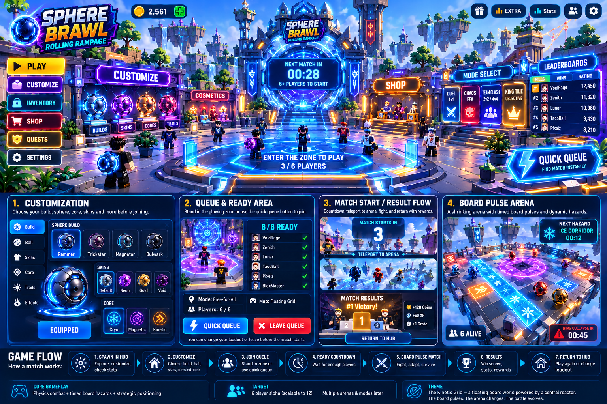

# SPHERE BRAWL: ROLLING RAMPAGE
## Master Implementation Plan and AI-Agent Production Specification

**Document version:** 1.2 - Consolidated source of truth with Gate 0 and spawn corrections; adds owner decisions D-019 to D-023 and Path A API usage D-025 (2026-10-20)  
**Status:** Approved design target; implementation values are initial tuning values unless marked as invariant  
**Engine:** Roblox Studio  
**Code:** Luau with `--!strict`  
**Intended builders:** AI coding/building agents (Claude Code, Google Antigravity, or another repository-aware agent)  
**Audience:** The orchestrating agent and any specialist coding, environment, UI, modelling, VFX, animation, sound, testing, or documentation agents



## Contents

- How to use this document (Section 0)
- Product vision and final target (Section 1)
- Theme, world logic, and art direction (Section 2)
- Frozen Alpha scope (Section 3)
- Full player journey and state flow (Section 4)
- Queue, lobby, and avatar lifecycle (Section 5)
- Arena geometry and collision-safe construction (Section 6)
- Board Pulse timed hazard system (Section 7)
- Sphere handling, cores, and combat (Section 8)
- Physics/network architecture decision (Section 9)
- Luau repository architecture (Section 10)
- AI-generated 3D assets, animation, VFX, sound, and UI (Section 11)
- Performance, security, and reliability (Section 12)
- Testing and acceptance strategy (Section 13)
- AI-agent execution protocol (Section 14)
- Milestone/task graph (Section 15)
- Final definition of done (Section 16)
- Key external technical references (Appendix A)

---

# 0. How to use this document

This is the **single source of truth** for Sphere Brawl: Rolling Rampage. Do not use older drafts as competing specifications. If an older note, concept image, prompt, generated script, or agent suggestion conflicts with this document, this document wins unless the human owner explicitly approves a change.

**Quality policy:** No written plan can guarantee zero defects in a complex multiplayer physics game. This specification removes avoidable ambiguity, freezes core decisions, defines acceptance tests, and prevents agents from claiming completion without evidence. A milestone is not complete until its verification gate passes in the target Roblox Studio environment.

Every AI agent must:

- Read this document and `AI_AGENT_GLOBAL_SYSTEM_PROMPT.md` before editing the repository.
- Work only on the assigned task and permitted files.
- Preserve all fixed identifiers, data contracts, geometry conventions, state names, and acceptance gates.
- Never silently invent a missing mechanic, use an unverified asset ID, or change balance values to make a test pass.
- Run the listed checks and report the actual command, result, and any limitation. Never claim a test ran when it did not.
- Stop at a blocker instead of introducing an unapproved architectural workaround.
- Update `DECISION_LOG.md` when an explicit decision is approved or a required assumption is confirmed.

## 0.1 Requirement labels

- **LOCKED** - Do not change without written owner approval.
- **ALPHA** - Required for the first playable, testable version.
- **LATER** - Deliberately deferred; do not implement during Alpha unless explicitly assigned.
- **GATE** - Work cannot proceed beyond this point until a measurable check passes.
- **TUNING** - Initial target. It may be adjusted only through documented playtest evidence and a decision-log entry.

## 0.2 Sources of truth and authority order

1. `MASTER_IMPLEMENTATION_PLAN.md` (this Markdown file) is the canonical product/engineering source.
2. `specs/DESIGN_CONSTANTS.md` is the canonical compact mirror for numeric constants; it must match this plan. If they disagree, stop and reconcile through an approved decision-log entry before coding.
3. Typed contracts and shared configuration committed in the repository, once accepted by the orchestrator.
4. The accepted task card for the current milestone.
5. Automated test expectations and the alpha acceptance checklist.
6. The approved visual concept image, for broad art direction/layout only.
7. DOCX and PDF files are rendered reading copies, not machine-readable sources of constants. Agents must never extract timing or geometry constants from PDF table text; read this Markdown file and `specs/DESIGN_CONSTANTS.md`.
8. Older notes and agent suggestions are reference only.

The concept art is a **visual direction reference**, not a pixel-perfect build specification. The play area, queue semantics, match timing, tile geometry, and security rules in text are authoritative.

---

# 1. Product vision and final target

## 1.1 One-sentence product definition

**Sphere Brawl: Rolling Rampage is a fast, physics-driven Roblox multiplayer brawler where players control customizable armored energy spheres, collide to launch rivals, and adapt to timed hazards on a floating board that shrinks as the match progresses.**

## 1.2 Final target for the first playable Alpha

The first playable Alpha must let a new player join a live server, explore a polished lobby, select a cosmetic sphere build and one elemental core, join matchmaking either by standing on the physical queue pad or pressing Quick Queue, enter a complete match against other players, experience the three scheduled Board Pulse hazards and two ring collapses, get eliminated or win, see results, and return to the lobby with the avatar and loadout restored.

A player must be able to complete that loop with keyboard/mouse, controller where supported, and mobile touch controls. The first Alpha does not need a live economy, paid items, ranked matchmaking, multiple simultaneous arenas, or cross-server matchmaking.

## 1.3 Why the game should be fun

The player is making three decisions continuously:

1. **Fight:** Which opponent can I hit, and from what angle and speed?
2. **Predict:** What hazard is about to activate, and where will safe routes remain?
3. **Exploit:** Can I use the hazard or arena edge to turn a good collision into an elimination?

The game should not be a passive bumper-car clone, and it should not be a random obstacle survival game. Collision skill decides local engagements; scheduled Board Pulse events change the tactical context; the shrinking board forces a finish.

## 1.4 Core gameplay pillars

- **Readable physics combat:** momentum, contact angle, and speed matter; light glancing contacts should not behave like charged frontal hits.
- **Scheduled environmental tactics:** hazards use deterministic patterns, warning cues, activation times, and reset times. Collisions do not create new hazards.
- **Counterplay:** every powerful ability and hazard has a readable cue and a plausible response.
- **Cosmetic expression:** players can show off chassis shells, ball skins, trails, impact effects, and emotes without paying for raw competitive power.
- **Short replayable rounds:** one Alpha match targets about 2 to 3 minutes plus queue/countdown time.
- **Mobile-readable action:** no essential information can depend only on tiny text, audio, or keyboard shortcuts.

---

# 2. Theme, world logic, and art direction

## 2.1 The world: The Kinetic Grid

The game takes place in **The Kinetic Grid**, a floating network of manufactured battle boards suspended around a central reactor. The reactor sends timed energy pulses through the grid. These pulses temporarily reconfigure selected floor lanes into ice, magnetic, or kinetic boost zones. The board is built to test pilots' control, prediction, and collision skill.

This theme provides a logical reason for every major system:

- **Kinetic Hub:** a safe social space for pilots to customize spheres, show cosmetics, and enter a match queue.
- **Queue Portal:** a physical matchmaking pad connected to the reactor network.
- **Arena:** a modular floating test board made of square plates with visible seams and neon edge lighting.
- **Board Pulse:** the reactor sends scheduled, announced hazard patterns through the floor.
- **Ring collapse:** the outer test-board rings are withdrawn as the trial escalates, forcing the match toward the central arena.
- **Cores:** Cryo, Magnetic, and Kinetic are the sphere's active energy systems.
- **Results podium:** the reactor recognizes the surviving pilot or team after the trial.

Do not add story cutscenes, lore books, or large narrative systems to Alpha. The theme should be communicated through environment design, signs, sound, color, and brief UI lines.

## 2.2 Visual direction

Use an original neon sci-fi / toy-like Roblox style inspired by the *broad layout conventions* of Roblox arena lobbies: a legible central plaza, peripheral feature stations, clear menu rails, high-contrast buttons, and a strong queue/play focal point. Do not copy existing game logos, proprietary models, exact UI assets, effects, or map layouts.

### Locked palette

| Role | RGB | Use |
|---|---:|---|
| Neutral tile dark | (32, 38, 54) | Main dark board tile |
| Neutral tile light | (42, 50, 70) | Checkerboard alternate |
| Cyan core / queue | (0, 195, 255) | Primary interact / technology color |
| Ice | (0, 235, 255) | Ice Corridor |
| Magnetic | (165, 55, 255) | Magnetic Storm and Magnetic core |
| Kinetic boost | (255, 125, 0) | Boost Runway and Kinetic core |
| Warning amber | (255, 170, 0) | Pre-hazard telegraph |
| Danger red | (255, 40, 40) | Ring-collapse warning and critical alert |
| Text primary | (245, 248, 255) | Main text |
| Text secondary | (170, 190, 215) | Supporting copy |

Use the colors consistently. Never rely on color alone: pair each hazard with a unique icon, surface motif, direction indicator, and sound cue.

## 2.3 Lighting and atmosphere

- Bright, high-contrast lobby; readable silhouettes and signs at normal camera distance.
- Arena skybox/clouds and floating islands support scale, but do not compete with active hazards.
- Moderate bloom; avoid overexposed neon that destroys tile-edge readability.
- No forced camera roll. Camera shake is brief, subtle, and user-toggleable.
- Use the same scene at lower particle/shadow quality on mobile.

## 2.4 Approved lobby layout

The Kinetic Hub is one open floating plaza. It is not a list of disconnected menus. Players spawn in the plaza and can see the central Queue Portal and major stations immediately.

**Top-down placement convention:** hub center at `(0, 150, -300)`. Treat this as the center of the top walking surface, not the platform part's geometric center.

| Area | Approximate center | Purpose |
|---|---|---|
| Main spawn | Position `(0, 150, -334)`, orientation `CFrame.lookAt(Vector3.new(0, 150, -334), Vector3.new(0, 150, -300))` | Spawn R15 avatar facing +Z toward the central Queue Portal; do not use an unrotated default CFrame |
| Central physical Queue Portal | `(0, 150, -300)` | Stand inside glowing pad to join queue |
| Customize station | `(-43, 150, -300)` | View and configure sphere loadout |
| Shop / cosmetics showcase | `(43, 150, -300)` | Alpha may show a non-purchasable preview only |
| Mode selection board | `(35, 150, -326)` | Free-for-All active; future modes marked Coming Soon |
| Leaderboard | `(35, 150, -274)` | Alpha session kills / wins; persistent leaderboard later |
| Optional reward display | `(-38, 150, -326)` | Cosmetic display only in Alpha |

All stations must be reachable by walking, not only by UI. The main queue pad must remain clear of decorative props and NPC displays. Quick Queue remains available in the screen UI.

---

# 3. Frozen Alpha scope

## 3.1 Included in Alpha

- One Kinetic Hub lobby environment.
- One floating arena using a 9 x 9 grid (81 cells initially).
- One active mode: Free-for-All, 4 to 6 players per match.
- One active match at a time per game server; players not selected for the current match stay in the lobby and may queue for the next one.
- R15 avatars in lobby; separate invisible collision sphere plus client-rendered visual shell in arena.
- Four selectable chassis names: Rammer, Trickster, Magnetar, Bulwark. For the first Alpha, these are cosmetic silhouettes with identical combat stats; sidegrade stats are LATER.
- Three selectable cores with the abilities defined in Section 8.
- Four starter sphere skins: Default, Neon, Gold, Void. If a skin is not unlocked, it appears locked and cannot be equipped. Alpha unlock rule (D-020): Default and Neon are unlocked; Gold and Void are previewable but locked and are rejected by LoadoutService; the unlock inventory is session-only on the server.
- Basic trails and collision/impact effects. Cosmetic only. IDs (D-021): `TrailId` = `None`, `CoreStreak`, `CyanStreak`; `EffectId` = `StandardSpark`, `CoreBurst`; all unlocked.
- Physical queue pad, Quick Queue, leave queue, queue counter, countdown, loadout lock, spawn assignment.
- Three timed hazards: Ice Corridor, Magnetic Storm, Boost Runway.
- Two scheduled ring collapses.
- Collision knockback, pair cooldown, elimination attribution, spectating, results and cleanup.
- Desktop and mobile UI; controller support where practical and tested.
- Automated unit/integration tests and a six-client local multiplayer test protocol.

## 3.2 Explicitly not in Alpha

- Duel 1v1, Team Clash, King Tile, ranked, cross-server queueing, public server browsing.
- Full economy, purchases, premium currency, trading, battle pass, daily quests, clan/guild system.
- Permanent stat advantages, pay-to-win upgrades, chassis stat progression.
- Procedural destruction triggered by every collision.
- Player-built circuits, tile placement, user-made maps, or more than the three approved hazard families.
- Persistent global leaderboard until server-side data and failure/retry handling are approved.
- Unreviewed third-party models, audio, textures, plugins, or code.

The UI may reserve space for later features but must label them `COMING SOON` and must not show dead clickable buttons.

## 3.3 Initial match values

| Setting | LOCKED Alpha value |
|---|---:|
| Match players | Minimum 4, maximum 6 |
| Hub server capacity target | 12 players for Alpha testing |
| Arena grid | 9 x 9 = 81 cells |
| Grid cell pitch | 12 studs |
| Arena footprint | 108 x 108 studs |
| Sphere collision diameter | 6 studs |
| Arena world center | `(0, 50, 0)` at grid center |
| Arena top surface | Y = 51 studs |
| Sphere spawn center | Y = 54.15 studs before settling |
| Void threshold | Y < 15 studs |
| Base horizontal speed target | 42 studs/s |
| Absolute horizontal speed cap | 55 studs/s |
| Spawn invulnerability | 2.5 seconds |
| Pairwise impact cooldown | 0.35 seconds |
| Knockout attribution window | 5.0 seconds after last valid hit |
| Results display | 8 seconds |
| Maximum active hazard tiles | 35% of currently live tiles, floor-rounded |

---

# 4. Full player journey and state flow

## 4.1 Player journey

1. **Join server:** R15 character spawns at the Kinetic Hub. Lobby navigation HUD becomes visible.
2. **Customize:** Player opens Customize UI or approaches kiosk, selects chassis, sphere skin, core, trail, and impact effect. The server validates every selection.
3. **Join queue:** Player either stands in the central glowing queue pad for one continuous second or presses Quick Queue. Both pathways call the same server QueueService; one UserId can only have one queue entry.
4. **Wait:** UI shows queued status, queue count, countdown, game mode, and leave-queue action. Loadout remains editable until the lock threshold.
5. **Roster locked:** Five seconds before match launch, server freezes the selected roster and loadout. Players receive a clear notification.
6. **Match loading:** Selected avatars move into hidden holding pods; a separate sphere root and the selected client visual shell are created at safe spawn points.
7. **Play:** Match phase and Board Pulse schedule begin. Players fight, read warnings, use one core ability, and avoid ring collapses.
8. **Elimination:** Eliminated player enters spectator mode; cannot affect physics, use abilities, or rejoin the same match.
9. **Results:** Server publishes winner, placement, KOs, survival time, and rewards. Show podium for eight seconds.
10. **Return:** Sphere is destroyed, saved avatar properties are restored exactly, avatar returns to Hub, loadout persists for that session, queue state is cleared or the player may opt into the next queue.

## 4.2 Authoritative state machine

Allowed RoundPhase values:

`Lobby -> Countdown -> Opening -> Collapse1 -> MidGame -> Collapse2 -> SuddenDeath -> Results -> Cleanup -> Lobby`

No other service may set the master phase. `RoundManager` owns transitions; other services request events through explicit methods.

| State | Entry actions | Exit condition |
|---|---|---|
| Lobby | Restore avatars, clear prior arena, accept loadouts/queue | Queue reaches start condition |
| Countdown | Freeze roster candidate as documented, display countdown | Countdown ends or roster invalidated |
| Opening | Spawn spheres; full board; opening Pulse timing | Two complete 28-second cycles have ended |
| Collapse1 | Warn and remove ring D=4 | Ring removed and state cleaned |
| MidGame | Board has 49 tiles; use mid-game Pulse timing | Two complete 21-second cycles end |
| Collapse2 | Warn and remove ring D=3 | Ring removed and state cleaned |
| SuddenDeath | Board has 25 tiles; use 15-second cycles | One survivor or match hard timeout |
| Results | Freeze combat, produce placements, show results for 8 seconds | Timer ends |
| Cleanup | Despawn spheres, restore avatars, clear events/connections | Reset invariants pass |

**Cycle timing invariant:** Opening is exactly two 28-second cycles (56 seconds) before Collapse1. MidGame is exactly two 21-second cycles (42 seconds) before Collapse2. SuddenDeath pulses repeat until one survivor or a 150-second hard match elapsed time is reached. On hard timeout, use the defined tiebreak: highest current placement score, then highest valid knockouts, then longest survival time; if still tied, declare a shared tie rather than randomizing. Placement score (D-022): every player alive at the timeout outranks every eliminated player; eliminated players rank by elimination time, latest first, and eliminations in the same server step share a placement.

## 4.3 Match-start conditions

- Queue size 6: start an 8-second full countdown immediately.
- Queue size 4 or 5: wait up to 25 seconds for more players; when the wait expires, start a 10-second partial countdown.
- Queue size 1 to 3: do not start. Continue waiting; show a calm `Waiting for at least 4 players` state.
- If queue reaches 6 during partial waiting, cancel the partial timer and start the 8-second full countdown.
- If queue falls below 4 before the countdown reaches zero, cancel the countdown, return eligible players to queued state, and explain why.
- At countdown T-minus 5 seconds, lock loadouts. Before that threshold, changes are allowed. After lock, server rejects the change and UI explains the lock.
- At final transition, revalidate each participant: still connected, still queued, valid loadout, not already in a match. If fewer than 4 remain, cancel match launch.

---

# 5. Queue, lobby, and avatar lifecycle

## 5.1 One queue implementation, two entry methods

`QueueService` owns one dictionary keyed by `UserId`. It is the only source of truth.

`QueueEntry` fields:
- `UserId: number`
- `Source: "Portal" | "QuickQueue"`
- `JoinedAt: number`
- `Eligible: boolean`
- `LoadoutSnapshot: PlayerLoadout?` (only frozen when roster locks)

**Physical Portal semantics:** entering the pad and remaining inside for 1.0 continuous second joins the queue with source `Portal`. If the player leaves the volume before the threshold, no entry is added. If a player queued via Portal leaves the pad, remove them after a 0.5-second exit grace period. Re-entering the pad can re-add them after a fresh 1-second dwell.

**Quick Queue semantics:** pressing the Quick Queue button joins the same queue with source `QuickQueue`. It persists if the player walks away from the pad, until they press Leave Queue, disconnect, or get assigned to a roster. If they are already queued through Portal, Quick Queue changes the source to `QuickQueue`; it does not create another record.

**Duplicate protection:** queue count is the number of unique eligible UserIds. Simultaneous Portal and UI requests result in one entry. All queue mutations occur on the server.

## 5.2 Queue API contract

Client may only request:
- `JoinQuickQueue`
- `LeaveQueue`
- `SelectMode` (Alpha server accepts only `FreeForAll`)

Client may not send a queue count, roster, countdown value, player list, reward, or arbitrary match destination. The server calculates and broadcasts `QueueStatePayload`.

Every remote must validate request shape and apply rate limiting. Repeat requests should be idempotent.

## 5.3 Loadout validation

The server owns allowed IDs and unlocked inventory. A client sends IDs, never arbitrary model instances or asset paths. For each request:
1. Validate argument is a string from the allowed enum list.
2. Validate category and ownership/unlock status.
3. Reject during match or after loadout lock.
4. Update server loadout snapshot.
5. Reply with canonical equipped loadout and rejection reason if applicable.

Do not trust client-set Attributes for money, unlocked items, class stats, cooldowns, or equipped abilities.

## 5.4 R15 to sphere lifecycle

Keep Roblox `Player.Character` as the lobby avatar. Do not replace/destroy it for the match.

At match start:
1. Save exact original values for every changed character part/decoration property and Humanoid movement property.
2. Move the avatar to a dedicated off-map holding pod from `LobbyConfig`, implemented as the `GameConfig.Lobby` section (D-023: six pods, anchored 10x1x10 floor, top Y=200, centred at `(2000 + 20*(i-1), 200, 2000)` for i = 1..6) (one unique pod per player, no collision with arena/lobby, anchored safe floor), remove it from collision interactions, anchor/disable the root as required, disable movement, and hide it without losing saved appearance properties. Never put the holding pod inside the active arena or in the player's camera view.
3. Spawn a separate `SphereRoot` physics instance in the match arena, registered against the player's UserId.
4. Bind client controls/camera to the sphere root or the approved predicted visual state.
5. On elimination, disable sphere input and ability requests, enter spectator camera, and keep avatar hidden until results.
6. On match cleanup, destroy sphere, restore every saved avatar property exactly, restore movement, and move character to a Hub spawn.

If the player disconnects at any phase, destroy their sphere, remove queue/roster references, clear connections, and update remaining-player count.

**Replication focus and restore matrix (D-023):** `Player.ReplicationFocus` follows the player's SphereRoot during play and the spectated root or an arena focus part while spectating, so StreamingEnabled streams the arena rather than the holding pod. Step 5 above is unchanged: the avatar stays hidden after elimination until Results/Cleanup.

| Event | Sphere | Input / ability | Camera | ReplicationFocus | Avatar |
|---|---|---|---|---|---|
| Elimination | removed from simulation, then destroyed | client bindings unbound; server rejects requests | spectator follow | spectated root or arena focus part | stays hidden in pod |
| Disconnect | destroyed; registry and references cleared | connections disconnected | n/a | n/a | saved-property record deleted |
| Match end, then Cleanup | all roots destroyed; client shells destroyed | all bindings unbound | `Custom`, subject = Humanoid | `nil` (default) | saved properties restored exactly, unanchored, moved to Hub spawn; missing Character triggers `LoadCharacter` |

Cleanup ends with an invariant check: no SphereRoot remains, no saved-property records remain, every player's ReplicationFocus is nil, and connection counts are back to baseline.

---

# 6. Arena geometry and collision-safe construction

## 6.1 Coordinate convention

- Grid center: `(0, 50, 0)`.
- Tile coordinates: integer `x,z` in `[-4,4]`.
- Tile pitch: 12 studs.
- `ArenaCFrame` is the full transform whose position is `(0,50,0)`; world tile center is `(ArenaCFrame * CFrame.new(12*x, 0, 12*z)).Position` via `CoordinateUtils`. Do not add the center position a second time.
- Ring index: `max(abs(x), abs(z))`.
- Ring D=4 has 32 cells; removing it leaves 49 cells.
- Ring D=3 has 24 cells; removing it leaves 25 cells.

## 6.2 Collision construction rule

Avoid having 81 overlapping collidable pieces per visible tile. Each grid cell has exactly one authoritative collision tile and separate non-colliding visuals.

**Per cell:**
- `CollisionTile`: anchored, invisible, `CanCollide=true`, size exactly `(12, 2, 12)`, center at the grid location, zero elasticity, friction controlled through movement code. Adjacent collision cells are edge-to-edge, with no physical gap.
- `VisualTile`: anchored, `CanCollide=false`, `CanTouch=false`, size `(11.8, 2, 11.8)`, center aligned with CollisionTile, color alternates by checkerboard parity. This creates a visible 0.2-stud groove while the physical collision surface remains seamless.
- `HazardOverlay`: anchored/non-colliding, size around `(11.4, 0.05, 11.4)`, placed just above visual tile top; effect changes color/texture/transparency locally.
- Edge accents/decals are visual only and do not collide.

Do not add a full-size collidable HitboxBridge on top of a collidable base. That creates stacked contact surfaces and contradicts the one-collider-per-cell rule.

### Collision-group matrix

Create named collision groups once during server startup and apply these interactions; `CanCollide=false` remains a safeguard for visual-only parts.

| Group A | Group B | Collide? | Reason |
|---|---|---:|---|
| `ArenaSphere` | `ArenaTile` | Yes | Sphere stands on live board cells |
| `ArenaSphere` | `ArenaSphere` | Yes | Physical combat contacts |
| `ArenaSphere` | `LobbyAvatar` | No | Lobby body cannot disturb active match |
| `ArenaSphere` | `LobbyWorld` | No | Arena sphere cannot hit lobby stations |
| `SphereVisual` | All groups | No | Client-rendered shell/VFX never participate in physics |
| `LobbyAvatar` | `LobbyWorld` | Yes | Normal lobby movement |
| `LobbyAvatar` | `ArenaTile` | No | Hidden/holding avatars cannot block arena |

The invisible queue query volume is non-colliding and must not be treated as a physical wall. Use the server's overlap/zone query for the 1-second dwell calculation, not client-reported position or a client-fired touch event.

## 6.3 Physics values and vertical alignment

Collision tile center Y=50 and height 2 gives top surface Y=51. Sphere diameter 6; spawn center Y=54.15 so it can settle onto the tile without starting in penetration. Void threshold is Y<15. Do not use hard per-frame Y snapping during normal movement; that would break falls and collision motion.

Set friction/elasticity with `CustomPhysicalProperties` on the collision tile and sphere root as specified in shared configuration. The core movement model supplies traction, braking, and ice slip mathematically. The visual shell is not part of the physics assembly.

## 6.4 Ring collapse

- Three-second visual warning: red border flash, crack decals, short warning audio.
- During warning, tile remains physically present and valid.
- At collapse timestamp, server marks cells `PendingCollapse`/destroyed according to the ring transition, disables their collision/query as needed, and starts the visual sink animation.
- Remove cells from live grid index exactly once.
- Active hazards must be reset/cancelled before ring collapse, so no event targets a ring while it is being removed.
- Any later pattern query must filter destroyed/pending-collapse cells.
- Cleanup must restore the full 81-cell board before next match.

## 6.5 Spawn positions

Use these six deterministic initial-match spawn slots exactly; do not generate random spawn positions. Each slot is centered on a live tile in ring D=3. Coordinates are arena-relative tile coordinates `(X,Z)` converted once using `ArenaCFrame:PointToWorldSpace(Vector3.new(12*X, 4.15, 12*Z))`. For the locked axis-aligned arena CFrame at `(0,50,0)`, this produces the world positions in the table. With the locked arena center `(0,50,0)`, the world-space sphere center Y is `54.15`. Do not add the center offset twice. These slots are for initial match spawn only; there are no mid-match respawns, and D=3 tiles later collapse at Collapse2.

| Slot | Grid cell `(X,Z)` | World position |
|---:|---:|---|
| 1 | `(0,-3)` | `Vector3.new(0,54.15,-36)` |
| 2 | `(3,-2)` | `Vector3.new(36,54.15,-24)` |
| 3 | `(3,2)` | `Vector3.new(36,54.15,24)` |
| 4 | `(0,3)` | `Vector3.new(0,54.15,36)` |
| 5 | `(-3,2)` | `Vector3.new(-36,54.15,24)` |
| 6 | `(-3,-2)` | `Vector3.new(-36,54.15,-24)` |

Spawn slots must be assigned by a stable player ordering (e.g. sorted UserId order, then slot index), not randomness. Tests must assert each slot maps to a live D=3 grid cell at match start, sphere centers are inside the tile bounds, and pairwise initial center distance is at least `12` studs. The minimum pairwise distance for this exact set is approximately `37.95` studs.

---

# 7. Board Pulse: deterministic timed hazard system

## 7.1 Core rule

**Only the PulseService activates arena hazards. Collisions never create hazard tiles.** Collisions can launch opponents into an existing hazard and can be amplified only by explicitly documented core or surface interactions; avoid undocumented per-hazard damage multipliers.

The server creates one `BoardPulsePayload` per cycle, containing pattern metadata and absolute server timestamps. Clients render warnings and VFX from those timestamps. The server's simulation/gameplay state activates and resets at those times. Send a fresh snapshot to late/rejoining clients.

## 7.2 Cycle timing (LOCKED)

| Phase | Safe combat | Warning | Active | Reset | Cycle length |
|---|---:|---:|---:|---:|---:|
| Opening | 14.0 s | 3.5 s | 7.0 s | 3.5 s | 28.0 s |
| MidGame | 10.0 s | 2.5 s | 6.0 s | 2.5 s | 21.0 s |
| SuddenDeath | 6.0 s | 2.0 s | 5.0 s | 2.0 s | 15.0 s |

Use `Workspace:GetServerTimeNow()` for payload timestamps and local visual alignment. Never depend on the moment a remote arrives as the exact activation moment. The receiver computes `remaining = timestamp - Workspace:GetServerTimeNow()` and handles late payloads without replaying obsolete warnings.

## 7.3 Hazard ratio rule

Maximum affected tile count is `floor(liveCellCount * 0.35)`. The pattern builder must design patterns that already fit. It must **not randomly or lexicographically truncate an oversized pattern**, because that creates broken asymmetric lanes. If a candidate pattern exceeds the cap, use the documented smaller pattern variant for that phase; log a test failure if the chosen pattern still exceeds the cap.

The affected-tile set is selected deterministically from `(Pattern, Phase, Meta, GridState)`, and the same metadata is used by server gameplay and all client visualizers.

## 7.4 Pattern A - Ice Corridor

**Appearance:** cyan/white frost, small snowflake icon, pale chevrons along the corridor, crystalline warning cue.  
**Gameplay:** reduce steering authority and lateral damping so existing momentum persists; do not change tile collision geometry.

Pattern equation in grid coordinates:
- `theta = radians(AngleDegrees)`
- `lateral = -x*sin(theta) + z*cos(theta)`
- `along = x*cos(theta) + z*sin(theta)`

Orientation options: 0, 45, 90, 135 degrees. Cardinal width selects 3 rows in Opening (`abs(lateral)<=1.0`) and one row in MidGame/SuddenDeath (`<=0.5`). Diagonal corridors use a half-width of 0.71 so the lane includes neighbor tiles needed for a continuous traversable strip. To respect the 35% cap, the diagonal lane may be shortened by phase: Opening full length; MidGame center segment `abs(along)<=2.8`; SuddenDeath center segment `abs(along)<=1.42`. Automated tests assert connectedness where a continuous lane is intended and count never exceeds the cap.

Starting movement modifiers while affected and not Cryo-immune:
- Steering authority multiplier: 0.45.
- Lateral damping: 25% of the configured normal lateral damping.
- No surprise launch or damage.

## 7.5 Pattern B - Magnetic Storm

**Appearance:** purple anchor tile, 2D concentric rings, subtle beams/tethers, low pulsing hum.  
**Gameplay:** apply a horizontal radial pull toward a selected anchor. No tile-to-tile damage chain.

Grid membership: `(x-anchorX)^2 + (z-anchorZ)^2 <= radiusTiles^2`. Choose an anchor such that its entire radius lies inside the currently live square; exclude destroyed and pending-collapse cells.

Starting radius:
- Opening: 2.8 tiles (33.6 studs).
- MidGame: 2.0 tiles (24 studs).
- SuddenDeath: 1.0 tile (12 studs).

Starting pull:
`a = 22 * (1 - d / radiusStuds)^2` studs/s^2 for `d < radiusStuds`, horizontal only. Cap hazard-added inward velocity contribution at 12 studs/s. If target's already accumulated velocity toward anchor meets/exceeds this cap, do not add more inward acceleration. Cryo Anchor Brake grants its defined temporary immunity.

## 7.6 Pattern C - Boost Runway

**Appearance:** orange ramps/chevrons with arrows, ascending turbine cue.  
**Gameplay:** each active tile gives a one-time velocity delta along the same direction for each sphere per event, not continuous acceleration every frame.

- Orientation is cardinal only: 0, 90, 180, 270 degrees.
- Selected cells are one row wide: `abs(lateral)<=0.5`.
- Every tile in the runway points in the same one-way direction.
- Initial delta velocity: +18 studs/s horizontally in the configured direction.
- Resulting horizontal speed clamps to 55 studs/s.
- Each sphere can trigger at most once on each BoostRunway event; a cooldown or event-id stamp prevents repeated per-frame triggers.

## 7.7 Randomness and repeat fairness

Server can randomize among legal pattern types/orientations but must use a server-owned `Random` instance and avoid repeating the exact same pattern/orientation on consecutive cycles if another legal option exists. Store the chosen `PatternMeta` in the payload; clients do not randomize independently.

No pattern may target destroyed tiles. No pattern may cover more than 35% of currently live cells. Warning begins before any physical effect. On phase changes, cancel current pulse, reset effects, collapse ring, then build the next phase's new schedule.

---

# 8. Sphere handling, cores, and combat

## 8.1 Separate simulation body and visual shell

- `SphereRoot`: invisible collidable sphere, diameter 6, authoritative gameplay object, contains root attachment/constraints required by the approved physics architecture.
- `VisualShell`: entirely non-colliding client-rendered model. It must not be an anchored part welded inside the physics assembly. The local visualizer creates/updates a shell for every visible sphere, following the replicated/predicted root position and applying roll visually.
- Camera follows a non-rotating position target/root position, not the rotating visual shell. The camera must not inherit shell roll.
- Visual shell rotation is computed from displacement: roll axis = world up cross horizontal travel direction; angle = traveled distance / visual radius. Skip update when distance is near zero. Clamp interpolation after large replication corrections; never allow visible mesh to control hitboxes.

### Sphere camera contract

- In Arena mode, use a client `Scriptable` follow camera so camera rotation never inherits sphere/root rotation. Restore the normal Roblox camera mode in the Hub.
- Focus point: sphere root position plus `(0, 2.0, 0)`. Default camera offset: 18 studs behind and 7 studs above the focus, with adjustable yaw/pitch.
- Clamp pitch to `-10` through `60` degrees. Apply mouse delta, touch drag, or right-stick input to yaw/pitch; do not use camera roll.
- Smooth position using `alpha = 1 - exp(-8 * deltaTime)` in the render step. Raycast from focus to desired camera position and move the camera inward when obstructed.
- On server-authority corrections, smoothly follow the corrected root without changing player aim or introducing camera roll. Respect the reduced-motion/shake setting.

## 8.2 Chassis (Alpha)

Rammer, Trickster, Magnetar, and Bulwark are cosmetic silhouettes in Alpha; set all combat multipliers to 1.0 to avoid power progression before the game has balance telemetry. Their visual differences:
- Rammer: heavier front plates and impact fins.
- Trickster: streamlined shell and angled panels.
- Magnetar: magnetic rings and small floating visual accents (non-colliding).
- Bulwark: thicker-looking armor plates and protective rim.

Future sidegrade stats require a separate balance milestone and explicit approval.

## 8.3 Cores and active abilities (LOCKED Alpha behavior)

Each player equips one core and gets exactly one active core ability. Server controls cooldowns and valid-state checks. Ability requests are commands, not proof that an effect should occur.

### Kinetic - Overdrive Dash
- Cooldown: 8.0 s.
- On activation, add +22 studs/s in normalized horizontal input direction; if no input, use current horizontal velocity direction; if both are near zero, use character facing direction.
- Clamp horizontal speed to 55 studs/s.
- Outgoing validated collision impulse factor: 1.25 for 1.0 s.
- No extra charges and no cooldown reset on hit.

### Cryo - Anchor Brake
- Cooldown: 9.0 s.
- On activation, remove 85% of current lateral drift component.
- For 2.5 s, ignore Ice Corridor steering/damping penalty and Magnetic Storm pull.
- For 2.0 s, reduce incoming collision knockback using victim resistance multiplier `1 / 1.5`.
- Immunity uses server simulation time and expires automatically.

### Magnetic - Pulse Tether
- Cooldown: 10.0 s.
- Select nearest live opponent within 24 studs using server simulation state; stable tie-break by UserId.
- Add a one-shot 16 studs/s velocity component toward the caster to the selected opponent, subject to absolute speed cap and combat cooldown rules.
- If no valid opponent is in range, ability fails, shows a brief `NO TARGET` state, and does not consume cooldown.
- Do not invent an alternate self-pull to a tile anchor; that behavior is not in Alpha.

## 8.4 Movement targets

| Parameter | Initial value |
|---|---:|
| Base acceleration | 85 studs/s^2 |
| Normal top speed | 42 studs/s |
| Absolute horizontal speed cap | 55 studs/s |
| Normal lateral damping coefficient | 6.5 |
| Longitudinal drag coefficient | 1.8 |
| Brake deceleration | 95 studs/s^2 |
| Ice steering authority | 0.45 x normal |
| Ice lateral damping | 1.625 (= 25% of normal) |
| Magnetic max acceleration | 22 studs/s^2 |
| Magnetic inward contribution cap | 12 studs/s |
| Boost runway delta | +18 studs/s one-time |
| Burst boost (Shift / touch Boost, D-019) | +12 studs/s one-time, 4 s cooldown, outgoing impact factor 1.0 |

These are tuning values. Unit tests verify the math; Studio multi-client playtests verify feel, safety, and stability. Do not silently alter them.

## 8.5 Impact validation math

The server determines valid hits from authoritative simulation state and a broad-phase candidate scan; do not trust a client-provided attacker/victim, collision result, velocity, contact normal, knockout, or tile ID.

For attacker A and victim B, use horizontal components:
- `n = normalize((P_B - P_A)_xz)`.
- `closingSpeed = dot((V_A - V_B)_xz, n)`.
- Ignore if distance is beyond contact tolerance, closingSpeed < 10 studs/s, either player is eliminated/invulnerable, or pair cooldown is active.
- `rawDeltaV = (closingSpeed - 10) * 1.15 * attackerOutgoingFactor * victimResistanceFactor`.
- Clamp `rawDeltaV` to `[0, 32]` studs/s for Alpha; never force a minimum impact after threshold.
- Apply victim delta along `n`; apply attacker recoil opposite `n` at 0.25 of the victim delta.
- Absolute horizontal speed remains <=55 studs/s after all modifiers.

This avoids a discontinuity in which a hit just above threshold receives an arbitrary minimum launch. If testing suggests the contact normal or closing-speed sign is wrong, the agent must add a focused two-body unit test rather than adjust sign heuristically.

Hit cooldown is keyed by the ordered-pair canonical key `min(UserIdA,UserIdB)..":"..max(...)`; both directions share one 0.35-second cooldown. Invulnerability, cooldown and last-hit time are server-owned.

## 8.6 Collision events and attribution

- Detection/scoring runs on server-authoritative state; `Touched` can provide optional diagnostics but is not the sole source of knockback or KO credit.
- On valid hit, record `LastAttackerUserId` and synchronized `LastHitAt` on server state.
- On falling below Y=15, credit last valid attacker only if age <=5 seconds, attacker is still valid, and hit was not invalidated by disconnect/round reset. Otherwise record Environment KO.
- Track `Knockouts`, `Assists` (later), `SurvivalTime`, and placement. Alpha does not require assist scoring.
- A player can be credited for a hazard-assisted KO; UI may label it `HAZARD KO` while retaining valid attacker credit.

---

# 9. Physics/network architecture decision (critical gate)

## 9.1 Why this is a gate

Traditional Roblox distributed physics gives an owning client significant control over the simulation of an unanchored assembly. The source draft proposed client-owned spheres while also describing knockback as server-authoritative, then asked the victim client to apply the actual impulse. That is not a clean single source of truth. It risks disagreement between clients and gives a compromised client too much control over competitive outcomes.

## 9.2 Required architecture for the target build

Gate 0 has two **pre-approved** paths. Try Path A first. If the current Studio build does not expose the required feature/settings/API, test Path B without changing the game rules. Do not use client-applied impulses as the fallback.

**Path A - Roblox Server Authority (preferred):**
- Enable `Workspace.AuthorityMode = Server` and the documented dependent Workspace settings in Studio. These are environment settings; do not assume a Rojo project file can set them.
- Put physics-affecting simulation and shared simulation state in a ModuleScript bound through `RunService:BindToSimulation()` and initialized on both client and server, following the current Creator Hub contract.
- Use Input Action System inputs for simulation inputs; use synchronized simulation time (`time()`) inside rollback/resimulation callbacks. Keep VFX, sounds, and other presentation outside simulation callbacks.
- Keep gameplay outcomes, knockback, elimination, queue state, and results server-authoritative.
- Prediction (D-025): the server creates the SphereRoot; each client calls `RunService:SetPredictionMode(ownRoot, Enum.PredictionMode.On)` after the root replicates and verifies `GetPredictionStatus(ownRoot) == Enum.PredictionStatus.Predicted`. Server code never calls `SetPredictionMode`.
- Input bridge (D-025): the simulation `Move` action is a world-space Direction2D (`Vector2(x, y)` maps to world `(x, 0, y)`) with one `Scriptable` binding. The client converts camera-relative hardware input to world space and fires `InputBinding:Fire` each frame outside the simulation; the simulation clamps the magnitude to <= 1. Never use the deprecated `InputAction:Fire`. Test automation feeds the same bridge, is gated by `RunService:IsStudio()`, and never ships in production controllers.
- Rollback safety (D-025): simulation callbacks write only synchronized state (velocities, attributes on predicted instances). Server-only outcomes are written as attributes with monotonically increasing sequence IDs; presentation and logging observe them outside the simulation and deduplicate by sequence ID.

**Path B - Server-owned physics fallback (pre-approved only when Path A is unavailable in the target environment):**
- Set every live `SphereRoot` assembly to server network ownership with `SphereRoot:SetNetworkOwner(nil)` on the server. This is not the Roblox Server Authority/rollback model; document it as server-owned simulation with server-authoritative outcomes.
- The client sends validated **input intents only** via `InputIntentRemote` at a fixed maximum rate of 20 updates/second per player (send when input changes plus a heartbeat refresh no faster than 20 Hz; the server rate-limits each player independently). Payload is a normalized 2D move vector and monotonically increasing sequence number; abilities remain discrete validated requests. Reject invalid vectors, stale/replayed sequence numbers, impossible state transitions, and over-rate requests.
- The server stores the latest valid intent and updates sphere forces/velocity in its server-side simulation step. Clients do not send position, velocity, hit, impulse, or KO claims. The server clamps movement to configured limits and computes collisions/knockback/eliminations from server-observed state.
- The owning client may interpolate/extrapolate **visual shell and camera presentation only** between server snapshots. Do not locally apply an impulse to a gameplay collider or let prediction determine hit/KO results.
- Run the same two-client and four-client movement/collision tests plus Studio Network Simulation at representative latency. If control is not acceptably responsive or outcomes disagree, mark Gate 0 `BLOCKED` and request owner review; do not create a third hybrid architecture.

**Gate 0 decision rule:** if Path A is exposed but the test fails, debug and retest Path A before selecting Path B. Choose Path B only when Path A's required setting/API is genuinely unavailable in the target setup. If neither path passes validation, stop. Record the chosen path and evidence in `docs/GATE_0_REPORT.md` and `DECISION_LOG.md`.

## 9.3 Simulation rules

- Under Path A, core movement and simulation-affecting state run in the shared `BindToSimulation()` path; use the documented synchronized simulation time source (`time()`) inside resimulated callbacks. Do not use `os.clock()`/`tick()` for rollback-sensitive simulation state.
- Under Path B, the server owns the assembly and processes latest validated input intents in the server-side simulation step; use a monotonic server clock for non-rollback timers and keep all client motion as presentation-only interpolation/extrapolation.
- In both paths, client requests are intent only; position, velocity, hit outcome, knockback, elimination, match timing, queue state, loadout ownership and rewards are decided by the server.
- Use the time source supported by the server-authority simulation model (`time()` for simulation-affecting clock logic where documented); do not use arbitrary client `os.clock()` to decide synchronized gameplay transitions.
- Keep UI, particles, camera, and sound outside rollback-sensitive simulation code. These systems observe simulation state and render feedback.
- Do not fire remotes every simulation frame for position updates. Use engine replication/prediction for physical state and discrete remotes for ability requests, match phases, queue, loadout, results, and cosmetic effects.
- `CombatFXEvent` may be an `UnreliableRemoteEvent` because lost cosmetic sparks are harmless. Queue/match/loadout/state changes use reliable communication.
- No remote tells the server what position the client reached or who was hit; clients submit inputs/action intent only.

## 9.4 Recovery behavior

- All simulation callbacks, input connections, render bindings, and event listeners must have explicit cleanup.
- If a sphere instance is missing, round state must not soft-lock. Server logs one structured error and requests safe elimination/cleanup.
- If predicted state is corrected, visual shell interpolates to the corrected root without camera roll or multi-stud snap where practical.
- If Path A is unavailable, use pre-approved Path B only after its Gate 0 tests pass. If the selected path fails movement, latency, or integrity checks, mark the build blocked; do not ship unvalidated competitive movement.

---

# 10. Luau repository architecture

## 10.1 Tooling baseline

Use Git as the source-control authority. Use Rojo for source-to-DataModel synchronization if installed/approved. Use strict Luau typing. Agent bootstrap must audit available tooling before writing code: Roblox Studio version, Rojo version, Luau analyzer availability, StyLua, Selene (if used), Blender (optional), ability to run local multi-client tests, and current branch/worktree status.

Do not claim code was tested in Studio if the agent only ran static checks. If Studio automation is unavailable, mark runtime checks `NOT RUN - environment unavailable`, provide an exact manual/test command, and block release acceptance.

## 10.2 Recommended file tree

```text
SphereBrawlRollingRampage/
  README.md
  default.project.json
  aftman.toml                  # only if tooling is actually managed by Aftman
  stylua.toml
  selene.toml                  # if Selene is installed/used
  src/
    shared/
      Types.luau
      Config/
        GameConfig.luau
        ChassisConfig.luau
        CoreConfig.luau
        AssetManifest.luau
      Modules/
        CoordinateUtils.luau
        PatternDefinitions.luau
        SimulationMath.luau
        Validation.luau
    server/
      ServerMain.server.luau
      Core/
        RoundManager.luau
        LobbyService.luau
        QueueService.luau
        LoadoutService.luau
        GridService.luau
        PulseService.luau
        SphereService.luau
        PhysicsValidator.luau
        AbilityService.luau
        EliminationService.luau
        ResultsService.luau
        CleanupService.luau
      Tests/
        Unit/
        Integration/
    client/
      ClientMain.client.luau
      Controllers/
        InputController.luau
        SphereMovementController.luau
        SphereVisualRig.luau
        CameraController.luau
        LobbyUIController.luau
        LoadoutUIController.luau
        HUDController.luau
        SpectatorController.luau
      Visualizers/
        PulseClientVisualizer.luau
        CombatFXController.luau
        VFXController.luau
        AudioController.luau
        LobbyShowcaseController.luau
      Tests/
  assets/
    models/
    textures/
    audio/
    animations/
    asset-manifest.json
  docs/
    MASTER_IMPLEMENTATION_PLAN.md
    DECISION_LOG.md
    ACCEPTANCE_CHECKLIST.md
```

Keep authoritative code in `ServerScriptService`/server source, shared pure definitions in `ReplicatedStorage`, and presentation code on the client. Do not put server secrets, data-store operations, queue ownership, or authoritative reward logic in replicated modules.

## 10.3 Remote contract

| Remote | Type | Direction | Payload purpose |
|---|---|---|---|
| `BoardPulseEvent` | RemoteEvent | Server -> clients | Cycle metadata, timestamps, current snapshot |
| `MatchStateEvent` | RemoteEvent | Server -> clients | Round phase, roster status, spectator/results transition |
| `QueueRequest` | RemoteEvent | Client -> server | Join/leave/mode intent only |
| `QueueStateEvent` | RemoteEvent | Server -> clients | Canonical unique queue count, timer, eligibility, roster display |
| `LoadoutRequest` | RemoteEvent | Client -> server | Category/item ID request |
| `LoadoutStateEvent` | RemoteEvent | Server -> clients | Canonical loadout + success/reason |
| `AbilityRequest` | RemoteEvent | Client -> server | Request to use currently equipped core ability |
| `InputIntentRemote` | RemoteEvent | Client -> server | Path B only: normalized move intent + sequence number, maximum 20 updates/second per player; unused under Path A Input Action System |
| `CombatFXEvent` | UnreliableRemoteEvent | Server -> clients | Optional cosmetic-only impact VFX; never carries authoritative score decisions |
| `ResultEvent` | RemoteEvent | Server -> clients | Final placement/KOs/survival/reward summary |

Do not create a `KnockbackEvent` that asks the victim client to apply the authoritative hit. The shared server-authority simulation resolves actual state; optional FX events merely display effects. Every request remote has server-side argument validation and rate limiting.

## 10.4 Type-contract rules

Create strict shared unions/types for:
- `RoundPhase`, `HazardPattern`, `PulseState`, `QueueSource`, `ChassisId`, `CoreId`, `SphereSkinId`, `TrailId`, `EffectId`.
- `PlayerLoadout`, `GridCell`, `PatternMeta`, `BoardPulsePayload`, `QueueStatePayload`, `MatchStatePayload`, `ResultPayload`.

The types must not assert that an instance or player exists when it can be absent; use optional types or validate before dereferencing. No `any` in project code without written justification and a narrow boundary cast.

## 10.5 Service ownership boundaries

- `RoundManager`: only component allowed to change master RoundPhase.
- `QueueService`: only source of queue membership/countdown roster candidates.
- `LoadoutService`: only source of canonical equipped IDs/unlocks/lock state.
- `GridService`: only source of tile life/destroyed state and ring collapse.
- `PulseService`: only source of current/next hazard pattern/timestamps and active hazard membership.
- `SphereService`: only source of sphere spawn/despawn/owner mapping.
- `PhysicsValidator`: only source of valid collision confirmation and knockback math.
- `AbilityService`: only source of core cooldown and ability effects.
- `EliminationService`: only source of elimination and kill attribution.
- `ResultsService`: only source of match result aggregation.

If two services need state, define a method or typed state object; do not read another service's private module table directly.

---

# 11. AI-generated 3D assets, animations, VFX, sound, and UI

## 11.1 Asset pipeline rule

AI agents may implement world geometry procedurally in Luau, create meshes with Blender Python when Blender is installed, create UI with Roblox Instances, script animation in Luau, and generate local audio assets when tools permit. The repo must remain buildable without non-approved third-party assets.

Preferred sequence:
1. Build functional greybox/procedural geometry using Roblox parts.
2. Verify scale, collision, camera, navigation, and performance.
3. Improve hero assets and station dressing only after mechanics are stable.
4. If Blender is available, keep `.blend` source and deterministic export script alongside FBX/OBJ assets; document import settings and expected names.
5. Every asset is recorded in `assets/asset-manifest.json` with source, license/ownership, dimensions, triangles or part budget, texture resolution, destination name, and whether it has been imported and verified in Studio.

Do not invent asset IDs. Do not rely on audio IDs copied from old documents until permissions and availability are verified for this experience. Unverified audio uses silence or a generated/imported placeholder, and is marked `ASSET_PENDING`.

## 11.2 Sphere assets

Construct 4 Alpha sphere chassis styles with identical physics dimensions and stats. All visible parts are non-colliding and do not affect mass/forces.

- Physics root: invisible sphere 6 x 6 x 6.
- Visual shell envelope: max diameter 5.6 studs so it stays inside the root collider.
- Bands: three orthogonal luminous bands, slightly inset so they do not protrude too far.
- Armor plates: up to 6 small bevelled plates attached visually, no extra colliders.
- Trails: use `Trail`/attachments with a short lifetime; disable or reduce on low-quality settings.
- Skin changes material/color/texture only; it must not change collider size or movement.

If custom meshes are generated, target <=5,000 triangles per sphere shell and <=1024x1024 texture for the main hero shell. Avoid dozens of high-particle emitters. Provide a procedural part-based fallback.

## 11.3 Lobby assets

Required items:
- Main circular/octagonal plaza 140-stud outer diameter, dark alloy floor, checker accents, cyan trim rings.
- Queue pad: clear circular/hexagonal ground pad radius 14 studs; visible cyan ring and floor prompt. A vertical portal frame is decorative, not a collision obstruction.
- Customize kiosk: 4 rotating sphere display pedestals, labeled chassis silhouettes, proximity interaction.
- Shop/cosmetics stand: decorative during Alpha, disabled purchase action.
- Mode board: Free-for-All active; future modes clearly labeled `COMING SOON` and non-interactive.
- Leaderboard display: session-only Alpha sample values from server state; no fake persistent claims.
- Portal/reactor core: segmented rings and floating panels; keep sight lines from spawn to queue zone clear.
- R15 player idle/walk animations use standard Roblox character behavior; custom emotes are later unless a verified animation asset is included.

## 11.4 Animation rules

- Sphere rolling is a client-side visual transform driven from travel displacement, not an animation that rotates the physics collider or camera.
- Hub display spheres rotate slowly at fixed speed and return to their default rotation after UI close.
- Portal rings rotate at different slow speeds; station showcase bobbing must use smooth bounded loops.
- Tile warning: 0.35-second sine pulse, 3-second warning duration for the collapse ring; hazard-specific warning duration follows cycle table.
- Tile activation: short fade-in <=0.2 seconds; reset fade <=0.25 seconds.
- Collapse visual: tiles shake <=0.15 studs, then sink/tilt over 0.5-0.8 seconds after server collision removal.
- Match result: brief podium highlight; do not force prolonged camera transitions.
- Every tween/connection/loop has a cleanup owner. Cancel previous tween before creating a new tween on the same visual target.

## 11.5 VFX specification

| Event | Main color | Motif | Initial budget |
|---|---|---|---|
| Light contact | Cyan/white | 6-12 sparks | <=12 particles per event |
| Heavy valid collision | Cyan/orange | Ring impact burst and short shockwave | 12-24 particles |
| Charged/ability hit | Core color | Distinct compact burst | 18-30 particles |
| Ice warning | Amber border + frost cyan preview | Frost chevrons, snowflake icon | No world-wide particles |
| Ice active | Cyan/white | Frost grid / subtle sheen | Low particle count |
| Magnetic warning | Amber to purple | Concentric rings closing to anchor | Use a few beams, not one beam per player-tile pair |
| Magnetic active | Purple | Anchor pulse and force lines | Max 1-2 visible lines per sphere, optional |
| Boost warning | Amber | Directional chevrons | One overlay per affected tile |
| Boost active | Orange/yellow | Flowing arrows | Short trail bursts on activation |
| Ring collapse warning | Crimson | Crack stripes and border pulse | No full-screen flash |

Camera shake amplitude target: `clamp(closingSpeed / 80, 0.1, 0.35)` studs, <=0.18 seconds, no roll rotation, settings toggle available. Reduce shake and emitters when reduced-motion setting is on or mobile quality is low.

## 11.6 Audio specification

Create/use four distinct short cues:
- Warning begins (unique per hazard family, ideally 3-note rising signature).
- Hazard activates.
- Valid heavy collision.
- Ring collapse warning.

Use short 3D spatial sounds on world events; avoid overlapping loops. Magnetic loop is limited to the active hazard duration and stopped/reset reliably. Sound IDs must be verified for permission/accessibility in the target experience. Until verified, maintain `ASSET_PENDING` and play no external audio; never silently borrow copyrighted or unavailable IDs.

## 11.7 UI rules

Build four modular ScreenGuis with `ResetOnSpawn=false` and a clear state owner: lobby navigation, customization modal, arena combat HUD, match results. Avoid hard-coded pixel coordinates as the only layout system; use scale sizing, constraints, safe-area padding, automatic text sizing limits, and separate mobile layout behavior.

### Lobby navigation
- Left rail: Play/Quick Queue, Customize, Inventory (Coming Soon), Shop (Coming Soon), Quests (Coming Soon), Settings.
- Top/corner: session currency only if implemented; otherwise omit rather than fabricate.
- Queue status: waiting count, match countdown, leave queue.
- Physical queue pad in world remains visible and usable even if HUD is hidden.

### Customization modal
- Left category tabs: Build, Ball, Skins, Core, Trails, Effects. (D-021: Build = chassis, Skins = sphere skin, Core, Trails, Effects; the Ball tab is shown disabled as `COMING SOON`.)
- Center: rotatable 3D preview in a ViewportFrame, with no physics and no persistent frame loop after close.
- Right: selection cards for Rammer, Trickster, Magnetar, Bulwark; available cosmetics; Cryo/Magnetic/Kinetic cores.
- Equip/apply confirmation state with server response. Lockout state while roster countdown <=5 seconds.

### Arena HUD
- Hazard banner: `NEXT HAZARD`, name, timer and icon.
- Alive counter.
- Ring-collapse timer.
- Ability button with cooldown overlay; Shift boost (Burst boost, D-019), Space brake, E core ability on keyboard; touch controls for all three.
- Optional center warning text that is short and fades, never hides a large portion of the field.

### Results
- Winner or shared tie, placement, KOs, survival time, optional hazard KOs, return to Hub.
- No reward economy displayed until a real server-side reward pipeline is implemented.

### Mobile layout acceptance
- At 16:9 1920x1080, 16:9 1280x720, 4:3 tablet, and narrow phone aspect, no critical HUD overlap or cut-off.
- Touch buttons are large enough for comfortable tapping and spaced to reduce mis-taps.
- Customization cards scroll rather than shrink text below readable size.
- Important hazard state is readable without sound.

---

# 12. Performance, security, and reliability standards

## 12.1 Server/client trust boundary

The server owns: queue state, selected roster, loadout allowlist/unlocks, round phase, Board Pulse metadata, tile live/dead state, ability cooldowns, valid impacts, knockouts, results, and any persistent data.

Clients own only: input collection, predicted presentation permitted by selected authority mode, local camera, UI, local visual shell, local particles/audio, and menu state. Client input is untrusted.

## 12.2 Remote security

For every remote, document:
- Direction and valid payload types.
- Minimum allowed call frequency and cooldown.
- Valid player state required (alive/in lobby/queued/eligible).
- Size limits and enum allowlists.
- Server response on rejection.

Never accept arbitrary Instance paths, asset ids to load, DataStore keys, UserIds other than the caller unless the feature explicitly requires them, self-reported position/velocity, client-decided kill attribution, or arbitrary reward values.

## 12.3 Performance targets (Alpha gate)

- 6 active spheres; 81 grid cells maximum, 25 at SuddenDeath.
- One central pulse payload per cycle plus state/snapshot changes; do not broadcast every tile's state every physics frame.
- No per-tile Script or Heartbeat loop. One GridService/PulseService owns board state.
- No unbounded coroutine/loop growth across rounds.
- Every service exposes `Destroy`/cleanup or equivalent for transient connections.
- Aim for smooth 60 FPS on a reasonable desktop; remain playable at 30 FPS on target mobile hardware. Instrument frame time rather than claim this without measurement.
- Profile server and client separately with MicroProfiler/Developer Console in six-client tests.
- Particle count and visual shell count must degrade gracefully at low quality.

## 12.4 Required structured diagnostics

Use a single logging helper with event name, round id, phase, player UserId when relevant, and concise details. Do not log every simulation frame. Log errors and state-transition summaries; gate verbose traces behind `RunService:IsStudio()` and a debug config flag.

## 12.5 Failure recovery

- Disconnection during queue removes entry and refreshes countdown logic.
- Disconnection during match removes sphere and re-evaluates survivor count.
- Queue countdown invalidation cancels cleanly.
- Missing `Player.Character` during cleanup schedules safe respawn and does not stop other players from returning.
- Missing tile part makes GridService mark cell unavailable and fail a test; no nil dereference.
- Asset/model missing falls back to procedural placeholder with a logged warning in development; release checklist must ensure all required assets are resolved.
- Failed DataStore (later phase) must preserve session play and retry safely; no Alpha data economy dependency.

---

# 13. Testing and acceptance strategy

## 13.1 Tool checks

Run if installed:
- `rojo build default.project.json -o build/SphereBrawl.rbxlx`
- `luau-analyze` or current Roblox Luau static analysis.
- `stylua --check src`.
- `selene src` if configured.
- Unit tests in Studio/TestService for pure math/config/service invariants.

The build may use different exact commands if the installed tooling version requires it. The agent must record the version and exact command. Never falsify a passing result.

## 13.2 Unit tests (mandatory)

1. `WorldToGrid(GridToWorld(x,z)) == (x,z)` for all cells in [-4,4].
2. Grid generation count=81; no duplicate keys; ring counts D4=32, D3=24.
3. `CollapseRing(4)` leaves 49 live cells; then `CollapseRing(3)` leaves 25.
4. Pattern builder never returns destroyed/pending cells.
5. Pattern tile count <= floor(live count * 0.35).
6. Boost orientation always cardinal and all runway directions are equal.
7. Ice diagonal strip remains connected for phases where specified.
8. Magnetic anchor/radius stay within live cells.
9. Pulse schedule state timestamps exactly match configured sums within 0.05 seconds (no runtime drift accumulation).
10. Ability requests reject when dead, cooldown active, wrong core, or outside permitted round phase.
11. Pairwise hit cooldown works in both A->B and B->A order.
12. Closing speed under 10 is ignored; closing speed above threshold gives bounded nonzero knockback.
13. Speed remains at or below 55 horizontal after dash, boost runway and magnetic pull.
14. KO credit expires after 5 seconds and does not survive match reset.
15. Queue operations are idempotent; one UserId always counts once.
16. Queue count transitions cancel/start countdown correctly.
17. Invalid chassis/core/skin IDs are rejected by LoadoutService.
18. All transient state and connections are cleared after round reset.

## 13.3 Integration tests (mandatory)

- Four-client match starts after partial-wait rules; six-client match starts with full countdown.
- Physical pad entry 1.0 second joins; step off before one second does not.
- Pad leave removes Portal-sourced queue entry after grace; QuickQueue entry persists until Leave Queue.
- Pad and Quick Queue simultaneous join results in one queue entry.
- At T-5, loadout locks and invalid changes are rejected.
- All clients see the same hazard layout and aligned warning/activation/end state from one payload.
- A boost tile activates a given sphere once per event, even if the sphere sits on the tile.
- Ring D4 collapse leaves exactly 49 collision tiles; D3 leaves 25.
- Eliminated player cannot move/use ability/affect collisions and can spectate.
- Results show correct placement; next round restores all avatars and all 81 cells.
- Three consecutive match cycles leave no old hazard state, stale connections, orphaned effects, or hidden avatars.

## 13.4 Network and input tests

Use Studio multi-client and network emulation to test representative latency and jitter. Verify that a client cannot self-award hits, change another player's sphere, duplicate itself in queue, equip an unowned item, skip loadout locks, or spoof KO attribution. Validate authority behavior in the actual target Studio version before building more systems.

## 13.5 Visual QA

Capture screenshots/video at lobby spawn, open customization, queue full, partial countdown, hazard warning, each active hazard, first collapse, second collapse, elimination/spectate, results, and mobile HUD. Compare against the approved art direction. Report the exact scene/state for each visual defect.

## 13.6 Release gate

No release/publish milestone passes unless all mandatory Alpha acceptance checklist items are marked PASS with evidence. Any NOT RUN/FAIL blocks release. Owner may accept documented non-critical visual defects only; no open security, queue, match-reset, physics authority, or elimination defects are accepted.

---

# 14. AI-agent execution protocol

## 14.1 Agent roles

- **Orchestrator agent:** owns branch integration, task order, decision log, shared contracts, and final QA. Only orchestrator merges work.
- **Gameplay/code agent:** implements assigned Luau service and tests.
- **Environment/3D agent:** creates procedural environment or Blender source/export scripts within approved asset contracts.
- **UI/VFX/audio agent:** creates UI hierarchy and visualizer code/asset manifest items; no gameplay-authority changes.
- **QA agent:** runs the checklist against the branch and reports evidence; should not silently fix code outside the QA task.

One agent may perform multiple roles, but file ownership must remain explicit. Do not have two agents edit the same file concurrently.

## 14.2 Mandatory agent workflow per task

1. Read task card, the relevant master plan sections, current types/configs, and current decision log.
2. Inspect existing repository and report current state before edits.
3. Write a short implementation plan with files to touch and tests to run.
4. Implement only the assigned scope.
5. Run formatting, static analysis, unit tests, and relevant build step.
6. Run Studio/runtime tests where available; if unavailable, state `NOT RUN` and why.
7. Review changes for accidental edits, unapproved values, unused remotes, stale connections, and TODOs.
8. Provide a completion report: changed files, behavior implemented, exact tests/commands, results, remaining issues, and gate status.
9. Wait for orchestrator acceptance before beginning the next task.

## 14.3 Agent stop conditions

Stop and report to the owner/orchestrator if:
- Required Studio authority mode/features are unavailable.
- A required asset import/upload permission is unavailable.
- The plan conflicts with actual engine APIs.
- A test needs to be weakened or deleted to pass.
- A task requires changing an approved contract or network remote schema.
- A change would delete user work or overwrite a file not generated by the agent.
- A visual concept conflicts with explicit gameplay geometry.

Do not solve these by guessing.

---

# 15. Milestone/task graph

Milestones are sequential because later systems depend on earlier data contracts. Environment/art/UI tasks can run in parallel only after their relevant contract and output path are frozen.

## GATE 0 - Environment and authority feasibility
**Owner:** Orchestrator + senior code agent  
**Outputs:** tool audit, Roblox Studio build/version, Rojo/analyzer availability, selected Path A/Path B architecture report, minimal 2-player sphere movement prototype, documented blockers.  
**Pass criteria:** chosen physics architecture runs a local two-player smoke test, inputs feel responsive, server owns truth, and no client-applied authoritative knockback is used.  
**Fail action:** If Path A is genuinely unavailable, evaluate the pre-approved Path B fallback exactly as defined in Section 9.2. Stop and request owner review only if the selected path fails validation or both paths are unavailable; no ad-hoc hybrid is permitted.

## TASK 01 - Project scaffolding and contracts
**Files:** `default.project.json`, `src/shared/Types.luau`, `src/shared/Config/*`, `CoordinateUtils.luau`, remote tree, README.  
**Pass criteria:** build succeeds; strict analyzer has no errors; every remote exists exactly once; coordinate round-trip tests pass.

## TASK 02 - GridService and arena collision geometry
**Files:** `GridService`, coordinate math, procedural geometry builder, grid tests.  
**Pass criteria:** exactly 81 live cells, unique IDs, one collidable part per cell, no collider gaps, correct ring counts, regeneration works twice.

## TASK 03 - Kinetic Hub environment
**Files:** `LobbyService`, procedural hub geometry, spawn/holding pods, station metadata, asset manifest.  
**Pass criteria:** clear line of sight from spawn to queue pad, all kiosks reachable, queue volume dimensions match spec, lobby avatar walkability tested.

## TASK 04 - Sphere lifecycle, movement and camera
**Files:** `SphereService`, shared simulation, input controller, visual rig, camera controller.  
**Pass criteria:** stable camera horizon, local shell roll independent from root collider, movement/stop/turn work, no seam snag, falls remain possible.

## TASK 05 - Board Pulse patterns and scheduler
**Files:** `PatternDefinitions`, `PulseService`, `PulseClientVisualizer`, pattern tests.  
**Pass criteria:** deterministic payloads; phase timings exact; all patterns inside cap; warning arrives before gameplay effect; event resets cleanly; late snapshot works.

## TASK 06 - Combat, core abilities and eliminations
**Files:** `PhysicsValidator`, `AbilityService`, `EliminationService`, combat tests.  
**Pass criteria:** head-on vs glancing tests pass; knockback capped; all three core abilities obey specs/cooldowns; no client-authoritative KOs; attribution expires correctly.

## TASK 07 - Queue/loadout validation and round lifecycle
**Files:** `QueueService`, `LoadoutService`, `RoundManager`, `ResultsService`, `CleanupService`.  
**Pass criteria:** all queue rules pass; round lifecycle is end-to-end; all avatars return; no leftover sphere/tile/effect state.

## TASK 08 - UI and mobile/controller input
**Files:** GUI controllers and layout specs.  
**Pass criteria:** every visible button works or is explicitly disabled as Coming Soon; loadout shows authoritative values; phone/tablet/desktop views avoid overlap; no menu obscures essential game state.

## TASK 09 - 3D modeling, animations, VFX and audio polish
**Files:** assets, manifests, visualizer improvements, effects controller, audio controller.  
**Pass criteria:** all required assets resolve or have approved procedural fallback; effects cleanup; low-quality mode is playable; no unverified IDs in release manifest.

## TASK 10 - Integrated QA and Alpha acceptance
**Files:** tests, bug reports, final checklist, performance report, screenshots/video.  
**Pass criteria:** all mandatory checks PASS, three consecutive matches complete, 4-6 players tested, mobile layout tested, authority/network gate revalidated, and no critical blocker remains.

## TASK 11 - Optional later production features (not Alpha blockers)
Persistent player data, cosmetic unlock pipeline, global leaderboard, cross-server matchmaking using approved platform services, other modes, ranked system, more arenas, seasonal progression. Each requires its own specification and acceptance gates.

---

# 16. Final definition of done

The project is considered **Alpha-ready**, not “perfect,” only when all of these are true:

1. The exact approved player journey works from Hub spawn to match results and return.
2. All fixed counts, dimensions, state names, timings, and core ability values match this document.
3. All core code is `--!strict` and has no known analyzer errors; exceptions are documented and approved.
4. The selected multiplayer physics architecture passed GATE 0 in the actual Roblox Studio target environment.
5. Unit, integration, multi-client, network and mobile checks have evidence attached to the build/task report.
6. At least three full rounds run back-to-back with no stale state or leaked transient resources.
7. No unverified third-party code, mesh, texture, animation or audio asset is included in the release path.
8. UI never offers a feature as working when it is not implemented.
9. All TODOs are categorized: `ALPHA_BLOCKER`, `LATER`, or `VISUAL_POLISH`; no unclassified TODO remains.
10. The final report distinguishes what was built, what was tested, what was not tested, and any remaining release risk.

---

# Appendix A. Key external technical references

These references support engine-specific decisions and must be checked against the actual installed Studio version during GATE 0.

- Roblox Creator Hub - Server authority model: https://create.roblox.com/docs/projects/server-authority
- Roblox Creator Hub - Network ownership, movement validation, and physics: https://create.roblox.com/docs/scripting/security/network-ownership
- Roblox Creator Hub - Security tactics: https://create.roblox.com/docs/scripting/security/security-tactics
- Roblox Creator Hub - RunService and simulation/render phases: https://create.roblox.com/docs/reference/engine/classes/RunService
- Roblox Creator Hub - UnreliableRemoteEvent (cosmetic/replaceable messages only): https://create.roblox.com/docs/reference/engine/classes/UnreliableRemoteEvent
- Rojo v7 project format: https://rojo.space/docs/v7/project-format/

**Current limitation:** The Roblox server-authority feature set and Studio configuration must be verified at implementation time. This plan deliberately requires a feasibility gate instead of assuming every property/API is enabled for every target experience.
